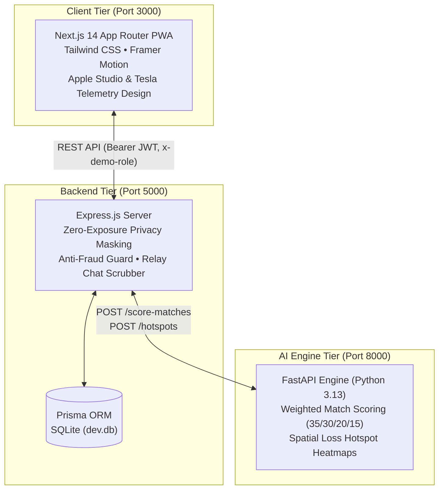

# FindIt Campus — Next-Gen AI Lost & Found Ecosystem

> **MITE Hackathon 2026** | Autonomous Spatio-Temporal AI Matching • Zero-Exposure Privacy Shield • Contactless QR Handover

FindIt Campus is an intelligent, privacy-first lost and found platform built for university campuses. Designed with an **industrial luxury aesthetic directly inspired by Apple (`apple.com`) and Tesla (`tesla.com`)**, it unites multimodal AI vision scoring, spatio-temporal campus telemetry, cryptographic contactless handovers, and a strict 9-stage chain-of-custody audit pipeline.

---

## Architecture Topology



---

## Key Capabilities

### 1. Apple Precision & Tesla Telemetry Aesthetic
- **Dual Studio Theme**: Pure Deep Obsidian (`#000000` / `#0A0A0C`) and Studio Off-White (`#F5F5F7` / `#FFFFFF`) with a 1-click theme toggle.
- **Hairline Borders & Frosted Glass**: Ultra-clean hairline borders with saturated Apple-grade blur (`backdrop-blur-2xl saturate-180`).
- **High-Contrast Accents**: Tesla Electric Crimson (`#E82127`) & Amber (`#FF4D2D`) for alerts, Apple Precision Blue (`#0071E3`) for CTAs, and Telemetry Emerald (`#10B981`) for approved states.
- **Top 48px Glass Header & Segmented Pill Dock**: Integrated with real-time Campus Depot telemetry pulse (`DEPOT ONLINE`) and instant persona switcher (`Student`, `Finder`, `Security`, `Admin`).

### 2. Multimodal AI Match Engine (FastAPI :8000)
- **Weighted Attribution Matrix**:
  - **Visual & Description (35%)**: Token set cosine overlap + color match bonus (+30) + brand correlation (+20).
  - **Category Taxonomy (30%)**: Exact hierarchy verification with attribute cross-checks.
  - **Spatial Proximity (20%)**: Distance decay across campus building coordinates (100% within 50m, decaying to 10% at 1000m; 95% for identical building).
  - **Chronological Delta (15%)**: Temporal proximity (100% within 2h, decaying across the 14-day window).
- **Natural-Language Attributions**: Generates 2–3 contextual explanation bullet points per candidate match.
- **Spatial Loss Heatmaps**: Aggregates loss density by campus quadrant, normalizing intensity from `0.15` to `0.95`.

### 3. Zero-Exposure Frosted Privacy Shield
- Hardware serial numbers, private distinctive markings, wallet contents, and finder contact phone numbers are protected behind an Apple-style frosted blur layer.
- Masked to `"REDACTED"` at the database/API level unless the requester has role `SECURITY`, `ADMIN`, or holds an `APPROVED` ownership claim.

### 4. Interactive Campus Spatial Radar (Tesla Vehicle-Map Style)
- Custom high-contrast vector SVG campus layout (Main Library, Tech Park, Student Union, Dining Hall, Sports Arena, Dorms).
- Building clusters with live item tallies, glowing telemetry pins, **"Near Me (200m)"** radar pulse filter, and Admin Loss Hotspot Heatmap overlay.

### 5. Multi-Stage Claim, Anti-Fraud Guard & Apple Wallet Pass
- **Student Claim Modal**: Prompts for secret distinctive marks known only to the true owner + purchase/proof image upload.
- **Security Verification Queue**: Split-screen side-by-side comparison view with fraud warning badges (`HIGH_VALUE_SIMULTANEOUS_CLAIM`) and 1-tap `Approve`, `Request Evidence`, and `Deny` buttons.
- **Apple Wallet-Style Handover Pass**: Approved claimants receive a digital card with dynamic QR code (`qrcode.react`), 6-digit tabular OTP, and live countdown timer.
- **Contactless Handover Station**: Security verification terminal validates QR/OTP, transitions custody state to `RETURNED`, and unassigns the locker vault.

### 6. Anonymous Relay Chat with Auto-Scrubber
- Ephemeral in-app communication between finder, claimant, and security staff.
- Built-in campus security desk appointment reservation scheduler.
- Automatic regex redaction of private phone numbers and URLs with `[REDACTED FOR SAFETY]` notices.

### 7. 9-Stage Custody Lifecycle & Telemetry Dashboard
- Stepper tracking all 9 custody states: `REPORTED` → `LOGGED_IN_DEPOT` → `MATCH_SUGGESTED` → `CLAIM_PENDING` → `VERIFICATION_APPROVED` → `AWAITING_PICKUP` → `RETURNED` → `UNCLAIMED_ARCHIVE` → `AUCTION_DONATED`.
- Real-time KPI telemetry cards (Recovery Rate %, Median Return Time, Active Locker Vault Capacity, Weekly Volume Trends).
- 1-Click Regulatory CSV Audit Export & 1–5 star post-recovery feedback rating modal.

---

## Tech Stack

| Layer | Technologies |
| :--- | :--- |
| **Frontend** | Next.js 14 (App Router), React 18, Tailwind CSS, Framer Motion, Lucide Icons, `qrcode.react` |
| **Backend** | Node.js, Express.js, Prisma ORM, SQLite (`dev.db`), JSON Web Tokens (JWT), UUID |
| **AI Engine** | Python 3.13, FastAPI, Uvicorn, Pydantic |
| **Design Language** | Apple Precision Design (`apple.com`) + Tesla Vehicle-Map Telemetry (`tesla.com`) |

---

## Service Ports & Quick Start

### 1. Prerequisites
- **Node.js**: v18+ (tested on v20.19.2)
- **Python**: v3.10+ (tested on v3.13.5)
- **npm**: v9+

### 2. AI Engine (Port 8000)
```bash
cd ai-engine
python3 -m venv venv
source venv/bin/activate
pip install -r requirements.txt
uvicorn main:app --host 0.0.0.0 --port 8000
```
*Health Check*: `http://localhost:8000/health`

### 3. Backend (Port 5000)
```bash
cd backend
npm install
npx prisma db push
node prisma/seed.js
node server.js
```
*API Base*: `http://localhost:5000`

### 4. Frontend (Port 3000)
```bash
cd frontend
npm install
npm run dev
```
*Web Application*: `http://localhost:3000`

---

## API Summary (`API_CONTRACT.md`)

| Method | Endpoint | Description |
| :--- | :--- | :--- |
| `POST` | `/api/auth/login` | Authenticates `.edu` credentials, issues JWT token and role profile |
| `GET` | `/api/items` | Queries items with optional type, category, distance radius (200m) filters |
| `POST` | `/api/items` | Logs new item, triggers AI match scoring |
| `GET` | `/api/items/:id/matches` | Returns AI ranked candidate matches with weighted score breakdown |
| `POST` | `/api/claims` | Submits ownership claim with Anti-Fraud Guard evaluation |
| `PATCH` | `/api/claims/:id/review` | Security staff review: APPROVE (generates QR/OTP), REQUEST_EVIDENCE, DENY |
| `POST` | `/api/handover/verify` | Validates QR token or 6-digit OTP, marks item `RETURNED` |
| `GET/POST`| `/api/chat/:itemId` | Anonymous relay messaging with phone/URL auto-scrubber |
| `GET` | `/api/analytics` | Telemetry KPIs, locker capacity, and weekly volume trends |
| `GET` | `/api/analytics/export.csv`| Streamed regulatory audit CSV file |
| `POST` | `/api/feedback` | Post-recovery 1–5 star rating submission |
| `POST` | `/score-matches` | (AI Engine :8000) Multimodal weighted similarity scoring |
| `POST` | `/hotspots` | (AI Engine :8000) Spatial loss density calculation |

---

## Demo Personas (1-Click Switcher)

| Role | Demo Handle | Focus |
| :--- | :--- | :--- |
| `STUDENT` | Alex Rivera (`alex.rivera@university.edu`) | Report lost items, file ownership claims, view digital QR pass |
| `FINDER` | Priya Sharma (`priya.sharma@university.edu`) | Fast-Log photo intake, drop-off coordination |
| `SECURITY` | Officer Dan Vance (`dan.vance@university.edu`) | Split-screen claim review, fraud alerts, locker assignments, OTP verification |
| `ADMIN` | Dean Elena Rostova (`elena.rostova@university.edu`) | Loss hotspot heatmap, custody lifecycle audit, CSV telemetry export |

---

## License

Created for the **MITE Hackathon 2026**.
